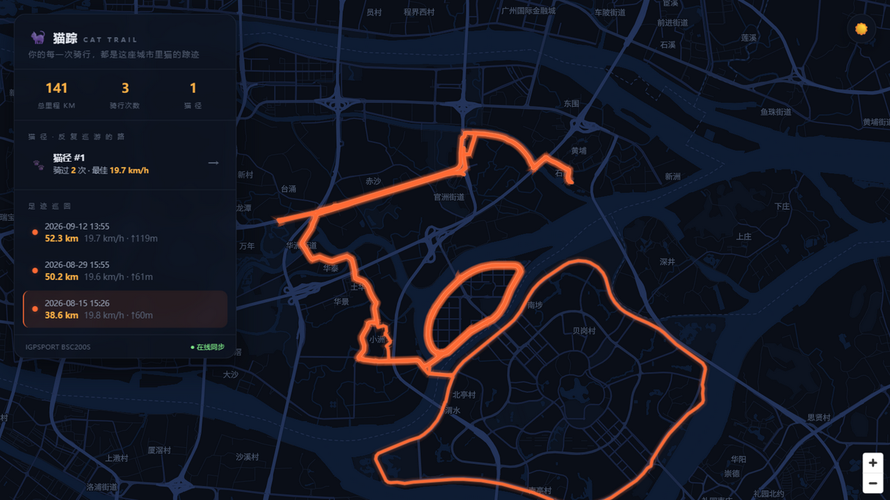
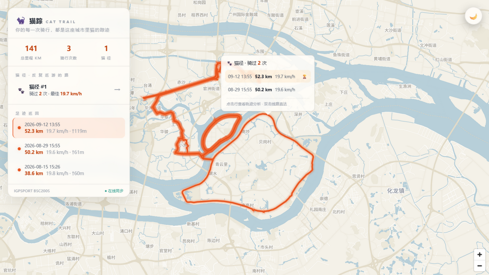

<div align="center">


# 猫踪 CatTrail

**你的每一次骑行，都是这座城市里猫的踪迹。**

[](LICENSE)
[](https://nodejs.org)
[](#合规与免责声明)



*夜巡：深夜蓝黑底图 · 猫瞳橙轨迹 · 全中文标注*



*晨巡：暖白纸感底图，一键切换*

</div>

---

把码表里每一次骑行，自动拉到一张自定义主题的地图上。项目名字里的 **CatTrail = 猫 + 轨迹（trail）**：
你绕过的每一个环岛、沿过的每一条江，都是这座城市夜里一只猫走过的路。

## ✨ 特性

| 状态 | 特性 | 说明 |
|---|---|---|
| ✅ | **iGPSPORT 自动同步** | 账号密码增量拉取本人全部骑行（详情 / FIT 原始文件），内置 ~1 req/s 限频 |
| ✅ | **FIT 手动导入** | 网页拖拽/选文件上传 .fit，解析入库自动去重覆盖，列表/地图/热力图即时刷新 |
| ✅ | **iGPSPORT 账号绑定** | 设置页自助绑定/换绑/解绑码表账号，凭据只存自部署服务器本地；一键增量同步 |
| ✅ | **夜巡黑猫地图主题** | 纯手写 MapLibre 样式：`name:zh` 强制全中文、深夜蓝黑底、猫瞳橙发光轨迹、起点猫爪印 |
| ✅ | **零成本底图** | OpenFreeMap 免费矢量瓦片，无需注册、无 API key、无配额；瓦片经自有后端 `/tiles/*` 直连转发 + 磁盘缓存，国内网络无需代理 |
| ✅ | **数据双模式** | 同一份数据契约：自有后端 API（正式部署）⇄ 静态快照（GitHub 演示页），一个环境变量切换 |
| ✅ | **相似线路聚类（猫径）** | 离散 Fréchet 距离 + 起终点预筛 + 并查集，自动识别反复骑行的线路，展示次数与最佳成绩 |
| ✅ | **历史骑行卡片** | 单击线路：小卡片列出这条线骑过的每一次数据，🏆 标记最佳 |
| ✅ | **轨迹分析抽屉** | 双击线路：速度 / 海拔 / 心率曲线（手写 SVG 渐变面积图）+ 六项数据网格 |
| ✅ | **夜巡 / 晨巡主题切换** | CSS 变量 + 底图样式联动，偏好持久化存储 |
| ✅ | **骑行历史页** | 近一年打卡热力图（GitHub contributions 风格）+ 骑行列表 + 居中详情卡片（大数字统计 / 速度海拔曲线 / 轨迹缩略图） |
| ✅ | **三页导航** | iOS 玻璃质感悬浮导航栏：地图 / 骑行历史 / 设置，切页过渡动效；设置页自助绑定码表账号 |
| 🚧 | 全国视图 + 省/市快速定位 | 离线行政区划反查，`flyTo` 平滑飞行 |
| 🚧 | 路书导出 | GPX / 分享卡片 PNG |
| ✅ | **骑行回放** | 光点沿轨迹移动 + 已骑路径渐进点亮（line-gradient），与图表指针共享同一进度；主题切换/中途打断均干净收场 |

## 🏗️ 架构

```
┌────────────┐   cron/手动    ┌─────────────────────────────┐
│ GitHub     │ ─────────────▶ │ apps/server                 │
│ Actions /  │                │  igpsport/  签名器 + 客户端   │
│ 自有服务器  │                │  sync/      增量同步 + 落盘   │
└────────────┘                │  store/     SQLite          │
                              └──────────┬──────────────────┘
                                         │ 同步产物写两份
                          ┌──────────────▼───────────────┐
                          │ data/*.json   静态快照(演示用) │
                          │ SQLite        正式存储        │
                          └──────────────┬───────────────┘
                                         │ 同一份数据契约
                              ┌──────────▼───────────────┐
                              │ apps/web  React + MapLibre │
                              │ VITE_DATA_MODE=server|static│
                              └──────────────────────────┘
```

- **正式部署**（`VITE_DATA_MODE=server`）：前端走 `/api/*`，iGPSPORT 凭据只存在于服务端环境变量，浏览器永远接触不到。
- **GitHub 演示页**（`VITE_DATA_MODE=static`）：Actions 跑完同步把 `data/` 构建进静态站，免费托管、无需服务器。
- **瓦片直连**：底图/字体请求走 `GET /tiles/*`，由后端 Node fetch 直连 OpenFreeMap（不走系统代理）并落盘缓存 30 天；TileJSON 中的瓦片地址会被改写到页面同源，浏览器全程不碰外网域名。
- 数据契约一致：`GET /api/activities` ≡ `data/index.json`，`GET /api/tracks` ≡ `data/tracks.json`。

## 🚀 快速开始

```bash
git clone https://github.com/lonely202602-ctrl/CatTrail.git
cd CatTrail
npm install

# 1. 配置凭据（iGPSPORT App 的账号密码）
cp apps/server/.env.example .env    # 填入 IGPSPORT_USERNAME / IGPSPORT_PASSWORD

# 2. 同步你的骑行数据（增量、限频 ~1 req/s）
npm run sync

# 3. 起服务看地图
npm run dev:server                  # API   → http://127.0.0.1:8787
npm run dev:web                     # 页面  → http://127.0.0.1:5173
```

静态演示模式（无需后端）：

```bash
VITE_DATA_MODE=static npm run build:web     # 读取 data/ 快照构建纯静态站
```

## 🗺️ 为什么不用高德 / Mapbox？

| 方案 | 问题 |
|---|---|
| 高德 | GCJ-02 坐标系与码表 GPS（WGS84）存在偏移，轨迹贴不上路；商业化使用需付费 |
| Mapbox | 需要 API key，超额收费 |
| **OpenFreeMap（本方案）** | 免 key、免注册、无配额；WGS84 与 GPS 数据天然对齐；样式 100% 自定义 |

## ⚖️ 合规与免责声明

- 本项目仅用于**访问和备份用户本人的运动数据**：所有接口调用均使用用户自己的账号凭据，不涉及任何第三方数据。
- 未逆向、未破解、未分发 iGPSPORT 的任何算法或代码：请求签名通过**运行时加载其公开网页的官方 WASM** 完成；若官方接口变更，本项目不保证可用性。
- 本项目与 iGPSPORT（武汉齐物科技）**无任何隶属或合作关系**；"iGPSPORT" 为其各自权利人的商标，此处仅作兼容性描述使用。
- 请勿高频请求（内置 ~1 req/s 限频，请勿移除）。使用本项目产生的任何后果由使用者自行承担。
- 代码以 [MIT](LICENSE) 协议开源；请遵守你所在地区的法律法规及 iGPSPORT 用户协议。

## 🙏 致谢

- [OpenFreeMap](https://openfreemap.org) — 免费无 key 的矢量瓦片
- [MapLibre GL JS](https://maplibre.org) — 开源地图渲染
- [fit-file-parser](https://www.npmjs.com/package/fit-file-parser) — FIT 解析
- [running_page](https://github.com/yihong0618/running_page) — 同类项目的先行者与思路参考

---

<div align="center">
<sub>🐈‍⬛ ride the night, leave the trace</sub>
</div>
