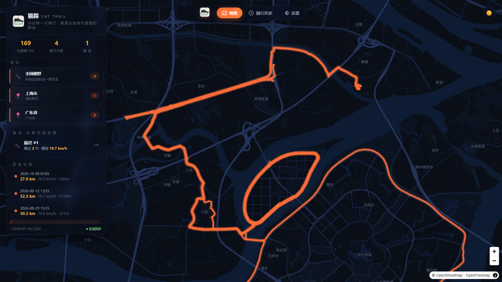
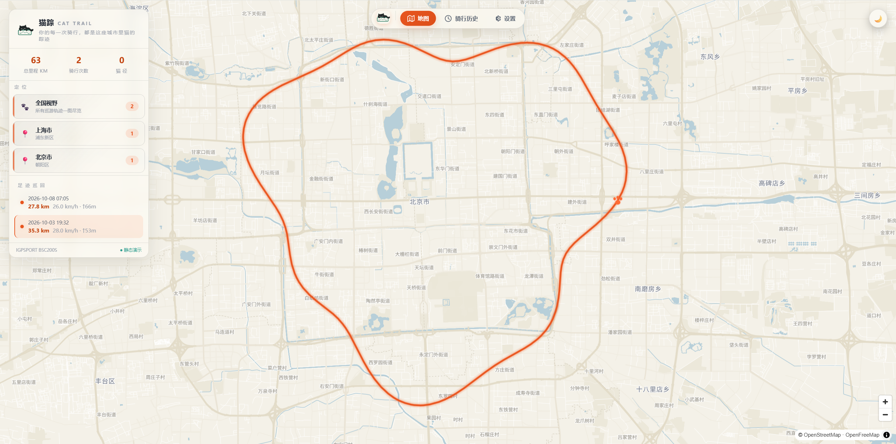
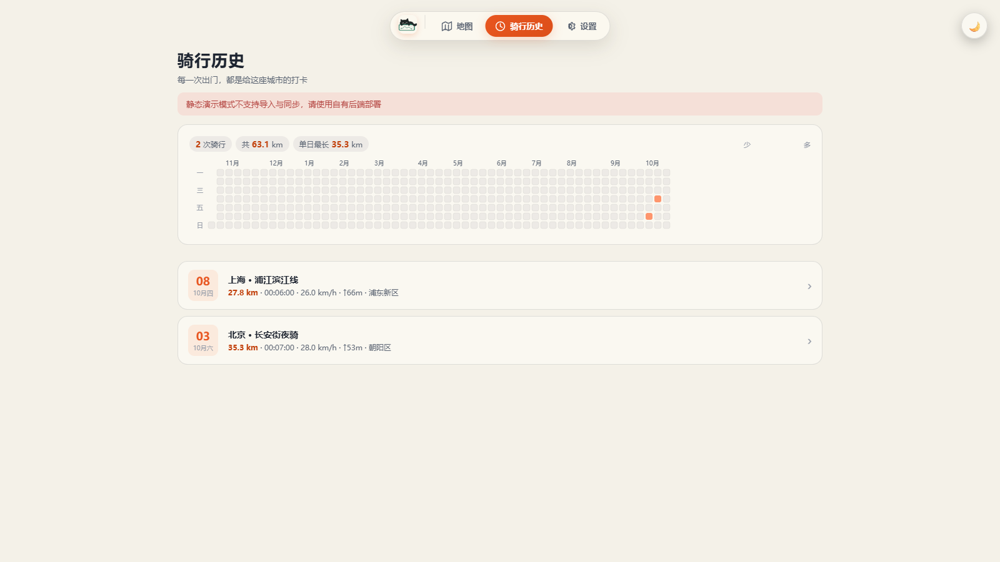

<div align="center">


# 猫踪 CatTrail

**你的每一次骑行，都是这座城市里猫的踪迹。**

[](LICENSE)
[](https://nodejs.org)
[](#合规与免责声明)



*夜巡：深夜蓝黑底图 · 猫瞳橙轨迹 · 全中文标注*



*晨巡：暖白纸感底图，一键切换*

</div>

---

把码表里每一次骑行，自动拉到一张自定义主题的地图上。项目名字里的 **CatTrail = 猫 + 轨迹（trail）**：
你绕过的每一个环岛、沿过的每一条江，都是这座城市里一只猫走过的路。

自部署、多用户、数据按账号隔离——绑一次码表账号，之后的每一次出门都自动变成地图上的一道猫爪印。

## ✨ 特性

**账号与数据**

- 🔐 **登录注册 + 数据隔离**：骑行数据按账号隔离，只有登录你自己账号才能看到；首个注册用户自动认领服务器里的存量数据
- 🔑 **iGPSPORT 账号绑定**：设置页自助绑定 / 换绑 / 解绑，凭据只存自部署服务器本地，浏览器与代码仓库都不落库
- 🚴 **iGPSPORT 在线同步**：增量拉取全部骑行（详情 / FIT 原始文件），内置 ~1 req/s 限频；后台任务执行，不阻塞页面
- 📎 **FIT 手动导入**：网页拖拽 / 选文件上传 .fit，解析入库自动去重覆盖（rideId 取起点时间）
- 🗑 **数据自主管理**：骑行可改名、可删除；内置演示数据明确标注、可一键清除

**地图与可视化**

- 🌙 **夜巡 / 晨巡双主题**：手写 MapLibre 样式（深夜蓝黑 × 猫瞳橙 / 暖白纸感 × 深橙），CSS 变量 + 底图联动切换
- 🐾 **足迹地图**：猫瞳橙发光轨迹、起点猫爪印、全中文标注（含港台简体）
- 🐈 **相似线路聚类（猫径）**：离散 Fréchet 距离 + 起终点预筛 + 并查集，自动识别反复骑行的线路
- 🎬 **骑行回放**：光点沿轨迹移动 + 已骑路径渐进点亮，与图表指针共享同一进度
- 📈 **轨迹分析**：双击线路查看速度 / 海拔 / 心率渐变面积图 + 六项数据网格
- 🗓 **骑行历史页**：近一年打卡热力图 + 骑行列表 + 居中详情卡片（真实地图底图轨迹）
- 🧭 **三页导航**：地图 / 骑行历史 / 设置，iOS 玻璃质感悬浮导航栏，切页过渡动效

**底图与部署**

- 🗺 **零成本底图**：OpenFreeMap 免费矢量瓦片，免 key、免注册、无配额；WGS84 与码表 GPS 天然对齐，样式 100% 自定义
- 🇨🇳 **国内直连**：瓦片经自有后端 `/tiles/*` 中转 + 磁盘缓存 30 天，浏览器全程不碰外网域名，国内网络无需代理
- 📦 **数据双模式**：自有后端 API（正式部署）⇄ 静态快照（纯静态演示页），一个环境变量切换

## 📸 页面一览

| 登录 | 骑行历史 |
|---|---|
|  |  |

| 设置（账号绑定 / 同步 / 导入） |
|---|
|  |

## 🏗️ 架构

```
┌────────────┐   cron/手动    ┌─────────────────────────────┐
│ GitHub     │ ─────────────▶ │ apps/server                 │
│ Actions /  │                │  auth/      注册登录 + 会话   │
│ 自有服务器  │                │  igpsport/  签名器 + 客户端   │
└────────────┘                │  sync/      增量同步 + FIT导入│
                              │  store/     SQLite(按用户)   │
                              │  tiles/     瓦片直连代理      │
                              └──────────┬──────────────────┘
                                         │ 按用户隔离入库
                          ┌──────────────▼───────────────┐
                          │ SQLite        正式存储        │
                          │ data/*.json   静态快照(演示用) │
                          └──────────────┬───────────────┘
                                         │ 同一份数据契约
                              ┌──────────▼───────────────┐
                              │ apps/web  React + MapLibre │
                              │ VITE_DATA_MODE=server|static│
                              └──────────────────────────┘
```

- **正式部署**（`VITE_DATA_MODE=server`）：注册登录后使用，骑行数据按账号隔离；iGPSPORT 凭据只存在服务器本地（base64 混淆、不入仓库），浏览器永不接触
- **GitHub 演示页**（`VITE_DATA_MODE=static`）：Actions 跑完同步把 `data/` 快照构建进纯静态站，免费托管、无需服务器（只含演示数据）
- **瓦片直连**：底图/字体请求走 `GET /tiles/*`，由后端 Node fetch 直连 OpenFreeMap（不走系统代理）并落盘缓存 30 天；TileJSON 中的瓦片地址改写到页面同源，浏览器全程不碰外网域名
- 数据契约一致：`GET /api/activities` ≡ `data/index.json`，`GET /api/tracks` ≡ `data/tracks.json`

## 🚀 快速开始

```bash
git clone https://github.com/lonely202602-ctrl/CatTrail.git
cd CatTrail
npm install

# 起服务
npm run dev:server                  # API   → http://127.0.0.1:8787
npm run dev:web                     # 页面  → http://127.0.0.1:5173
```

1. 打开页面，**注册**你的账号（首个注册用户自动认领服务器里已有的骑行数据）
2. 进入 **设置 → iGPSPORT 账号**，绑定你的码表账号（或直接在骑行历史页拖入 .fit 文件）
3. 点击 **立即同步**，等数据入库后回到地图即可

> 命令行党：也可以 `cp apps/server/.env.example .env` 填入凭据后 `npm run sync` 完成首次导入，
> 再进页面绑定账号改用在线同步。

静态演示模式（无需后端、不含真实数据）：

```bash
VITE_DATA_MODE=static npm run build:web     # 读取 data/ 演示快照构建纯静态站
```

## 🔐 数据与隐私

- 骑行数据（轨迹 / 逐秒序列）存放在**你自己部署的服务器** SQLite 中，按账号隔离，未登录无法访问
- iGPSPORT 凭据以 base64 混淆存于服务器 `.cache/`（已被 .gitignore 排除），**不会提交到代码仓库**
- 仓库内的 `data/` 仅包含**合成的演示数据**；你的真实骑行轨迹不会进入 git

## ⚖️ 合规与免责声明

- 本项目仅用于**访问和备份用户本人的运动数据**：所有接口调用均使用用户自己的账号凭据，不涉及任何第三方数据。
- 未逆向、未破解、未分发 iGPSPORT 的任何算法或代码：请求签名通过**运行时加载其公开网页的官方 WASM** 完成；若官方接口变更，本项目不保证可用性。
- 本项目与 iGPSPORT（武汉齐物科技）**无任何隶属或合作关系**；"iGPSPORT" 为其各自权利人的商标，此处仅作兼容性描述使用。
- 请勿高频请求（内置 ~1 req/s 限频，请勿移除）。使用本项目产生的任何后果由使用者自行承担。
- 代码以 [MIT](LICENSE) 协议开源；请遵守你所在地区的法律法规及 iGPSPORT 用户协议。

## 🙏 致谢

- [OpenFreeMap](https://openfreemap.org) — 免费无 key 的矢量瓦片
- 地图数据 © [OpenStreetMap contributors](https://www.openstreetmap.org/copyright)（ODbL 开放许可）
- [MapLibre GL JS](https://maplibre.org) — 开源地图渲染
- [fit-file-parser](https://www.npmjs.com/package/fit-file-parser) — FIT 解析
- [running_page](https://github.com/yihong0618/running_page) — 同类项目的先行者与思路参考
- 本开源项目已链接并认可 [LINUX DO](https://linux.do) 社区 — 真诚、友善、团结、专业，共建你我引以为荣之社区

---

<div align="center">
<sub>🐈‍⬛ ride the night, leave the trace</sub>
</div>
